# 📐 Day 24 Architecture Notes: Document Parsing · Chunking · Metadata · Indexing 파이프라인 설계

**핵심 아키텍처 요약**: Day 24에서는 11/18 기반(E5-small 384차원, pgvector Top-k 검색)을 그대로 재사용하면서, 원본 파일로부터 검색 가능한 단위와 출처를 준비하는 Document Ingestion Pipeline(Collect → Parse → Clean → Chunk → Validate → Metadata → Index)을 구축하며, 내일(**11/20 Basic RAG**)의 Context Builder 및 LLM Client와 안전하게 연결할 수 있는 데이터 계약을 완성합니다.

---

## 🔄 1. 전체 파이프라인 흐름 (End-to-End Ingestion Flow)

질문이 들어올 때마다 원문 문서를 다시 처리하지 않고, **사전 준비(Ingestion) 경로**와 **질문 검색(Retrieval) 경로**를 명확히 분리합니다.

```mermaid
flowchart LR
    A[Raw Files<br/>TXT·MD·HTML·PDF] --> B[01. Collect<br/>bytes · SHA-256]
    B --> C[02. Parse<br/>ParsedUnit · Locator]
    C --> D[03. Clean<br/>NFC · Whitespace]
    D --> E[04. Chunk<br/>Window · Structure]
    E --> F[05. Validate<br/>Span · Coverage]
    F --> G[06. Metadata<br/>ID · Category · Version]
    G --> H[07. Embed & Index<br/>E5-small · pgvector]
    H --> I[08. Retrieve<br/>citation_id · body]
    I -.-> J[Next: 11/20 Basic RAG<br/>Context → LLM → Validator]
```

### 전후 차시와의 아키텍처 연결
| 시점 | 담당 계층 | 유지 및 확장 내용 |
| :--- | :--- | :--- |
| **11/10–11 (기반)** | FastAPI · PostgreSQL 18.6 | 기존 DB 서버와 가상환경 유지 (전용 Schema 분리 사용) |
| **11/16–17 (기반)** | Context · Prompt · LLM Client · Validator | `KnowledgeAnswer.source_ids: list[int]` 출력 계약 유지 |
| **11/18 (Day 23)** | Embedding · pgvector · Retriever | `intfloat/multilingual-e5-small`(384차원), `query:` / `passage:` 접두어, Cosine Distance(`<=>`) 재사용 |
| **11/19 (Day 24 · 오늘)** | **Document Ingestion Pipeline** | 원본 수집부터 파싱·정제·분할·검증·메타데이터·안전한 버전 공개까지 구축 (생성형 답변 미포함) |
| **11/20 (예정)** | **Basic RAG 통합** | 오늘 검색한 `citation_id`·`body`·`source_locator`를 Context Builder와 LLM Client에 연결 |

---

## 🏗️ 2. 핵심 아키텍처 설계 원칙 (Core Principles)

1. **원본 불변성 (Immutable Raw Files)**
   - 원본 파일은 절대 덮어쓰지 않고 순수 `bytes`로 읽어 `raw_sha256` 지문을 남깁니다.
   - 파싱(`ParsedUnit`), 정제(`CleanUnit`), 분할(`Chunk`) 결과는 모두 파생 데이터(Derived Data)로 분리 보관하여 규칙 변경 시 언제든 원본부터 재처리할 수 있습니다.
2. **Fail-Fast 및 상태 정직성 (No Silent Failures)**
   - 없는 파일(`FileNotFoundError`), 잘못된 UTF-8 바이트(`UnicodeDecodeError`, `errors="ignore"` 금지), 잘못된 Span(`ValueError`)은 임의의 빈 값으로 넘기지 않고 즉시 실패시킵니다.
   - 스캔 PDF(`needs_ocr`), 지원 외 형식(`unsupported`), 오프라인 준비 완료(`prepared_not_embedded`) 등 실행 상태를 정확히 분리해 리포트합니다.
3. **결정적 식별자 (Deterministic `chunk_id`)**
   - Python 내장 `hash()` 대신 `doc_id`, `source_version`, `pipeline_version`, `unit_id`, `span`을 정렬된 JSON(`sort_keys=True`)으로 직렬화한 뒤 `SHA-256` 해시로 생성해 재실행 시 멱등성(Idempotency)을 보장합니다.
4. **트랜잭션 외부 추론 & 원자적 공개 (Staging → Publish)**
   - 무거운 E5 모델 추론은 DB 트랜잭션 바깥에서 미리 끝내고, DB 트랜잭션 내부에서는 `staging → expected_count 확인 → ready → current 포인터 전환`만 짧게 원자적으로 처리합니다.
5. **명시적 출처 매핑 (Citation Bridge)**
   - 문자열 `chunk_id`를 `KnowledgeAnswer.source_ids(list[int])`에 바로 넣지 않고, DB가 발급한 양의 정수 `citation_id`와 `chunk_id`·`source_locator`의 매핑을 유지합니다.

---

## 📦 3. 8단계 모듈별 구현 및 입출력 계약 (`01` ~ `08`)

| 단계 | 모듈 폴더 | 핵심 함수 | 입력 → 출력 계약 | 주요 검증 포인트 |
| :---: | :--- | :--- | :--- | :--- |
| **01** | `01_collection` | `read_raw`, `build_record` | `Path` → `bytes` / `collection.json` | 원본 불변 읽기, `size_bytes` 일치, 64자리 `raw_sha256` |
| **02** | `02_parsing` | `decode_text`, `make_unit` | `bytes` → `str` / `ParsedUnit` | 엄격한 UTF-8 디코딩, TXT는 `page_number=None` 유지 |
| **03** | `03_cleaning` | `unify_newlines`, `reduce_horizontal_spaces` | `raw_text` → `clean_text` | `CRLF/CR → LF` 순서 준수, 줄 단위 공백 축소로 문단(`\n\n`) 보존 |
| **04** | `04_chunking` | `check_params`, `make_windows` | `clean_text` → `list[Span]` | `0 <= overlap < size` 강제, `end == len(text)` 시 `break`로 꼬리 청크 방지 |
| **05** | `05_validation` | `check_bounds`, `check_content` | `(Span, clean_text)` → 통과 / 예외 | `0 <= start < end <= len(text)`, `text == clean_text[a:b]`, 공백 청크 차단 |
| **06** | `06_metadata` | `attach_metadata`, `select_category` | `(Chunk, Doc)` → 필터링된 `Chunk` | `doc_id`·`source_version`·`category`·`source_locator` 불변 결합 및 순서 보존 필터링 |
| **07** | `07_indexing` | `select_index_chunk`, `format_hit` | `doc_id` → `Chunk` / `live_db` 결과 | `passage: ` 접두어 검증, 양의 정수 `citation_id` 직렬화, `--live-db` 연동 |
| **08** | `08_daily_project` | `run_pipeline`, `check_report` | `doc_id` → `daily_project.json` | 전체 전처리 연결, `c['body']` Span 전수 검증, `status: 'prepared_not_embedded'` |

> **심화(`04_chunking` Advanced) 핵심 확장**: 문단 경계 우선 분할 후 긴 문단만 재분할하며 전체 기준 절대 Offset(`s['char_start'] + w['char_start']`)을 유지합니다. `passage: `와 `section_title`은 임베딩 입력에만 포함하고 Offset에는 섞지 않습니다.

---

## 🗄️ 4. PostgreSQL + pgvector 스키마 및 안전한 버전 공개 전략

### 전용 스키마와 3개 테이블 분리 (`python tools/setup_db.py --apply`)
기존 `public` 스키마 데이터를 보존하고, 실습별 전용 스키마(`d24_basic07` 등)에 아래 3개 테이블을 구성합니다.
- **`ingest_documents`**: 문서별 현재 공개 포인터(`current_version`, `current_pipeline_version`) 관리
- **`ingest_versions`**: 버전별 상태 머신(`staging` / `ready` / `failed`) 및 기대 청크 수(`expected_count`) 관리
- **`ingest_chunks`**: `citation_id`(정수 PK), `chunk_id`(UNIQUE), `body`, `embedding vector(384)`, `metadata jsonb`, `source_locator`, `char_start`/`char_end` 저장

### 왜 `UPSERT`만으로는 부족한가?
- 문서가 `v1`(청크 A, B, C)에서 `v2`(청크 A, B)로 개정되어 청크가 줄어든 경우, 단순 `UPSERT`는 `v1`에만 존재하던 C를 자동 삭제하지 못합니다.
- 따라서 **`v2`를 `staging`으로 준비·검증 → 단일 `Transaction`에서 `SELECT ... FOR UPDATE` 잠금 및 `expected_count` 확인 → `ready` 전환 → `current` 포인터를 `v2`로 교체**합니다.
- 도중 오류가 발생하면 `ROLLBACK`하여 기존 정상 버전(`v1`)의 검색 노출을 안전하게 유지합니다.

---

## ⚠️ 5. 반드시 기억할 4대 반례 및 테스트 실행 가이드

### 실무에서 자주 착각하는 4가지 반례
1. **수집 수 ≠ 파싱 성공 수**: 스캔 PDF(`needs_ocr`)나 지원 외 형식(`.xyz`, `unsupported`)은 수집되었더라도 파싱 성공으로 집계하지 않습니다.
2. **문자 길이 ≠ Token 길이**: 384차원은 출력 벡터 크기이며, 입력 길이 한도는 `passage: `와 Heading을 포함한 최종 문자열을 `E5 Tokenizer(truncation=False)`로 직접 측정해야 합니다.
3. **Coverage 100% ≠ 원문 의미 보존**: 구간 병합 기반 Coverage 100%라도 앞선 Parsing 누락, Cleaning 부정어 훼손, 중복 `chunk_id` 오류는 별도로 검출해야 합니다.
4. **Top-k 후보 ≠ 답변 정확성**: `WHERE category = ... AND current_version` 필터 후 Top-k 후보를 찾았더라도, 질문에 답할 사실이 충분한지는 원문 근거 대조가 필요합니다.

### 실행 및 검증 환경 가이드
- **오프라인 계약 검증 (기본)**: 각 실습 폴더 루트에서 `python main.py` 및 `pytest` 실행 (`1 passed` 확인)
- **실제 E5 + pgvector 연동 (`--live-db`)**:
  1. 상위 `20261119/mentee/.env`에 PostgreSQL 접속 정보 배치 (공통 모듈 `coursekit/live.py`가 단일 `.env` 공유)
  2. `python tools/setup_db.py --apply`로 전용 스키마 초기화
  3. `python main.py --live-db` 실행으로 실제 임베딩·Staging·Publish·Top-k 검색 확인