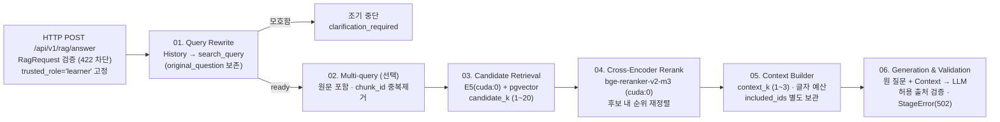

# Day 27 · LangChain RAG & Reranking 실습 종합 보고서

> **수행 일자**: 2026-11-24  
> **실습 트랙**: `01_basic` (`01_failure_diagnosis` ~ `08_enhanced_rag_api` 전 과정 완료)  
> **실행 환경**: Windows 11 · Python 3.13 (`.backendenv`) · NVIDIA GeForce RTX 5080 (16GB VRAM, CUDA `cu128`) · PostgreSQL (`knowledge_lab`, `pgvector`, 스키마 `d27_rag`)

---

## 1. 핵심 아키텍처 요약

Day 26의 기본 RAG(`E5 + pgvector` · `Document` · `Prompt` · `LLM` · `Validation`) 계약을 유지한 채, **Retriever 앞단(Query Transformation)**과 **뒷단(Cross-Encoder Reranking)**을 LangChain LCEL(`RunnableLambda`, `|`, `.invoke()`) 파이프라인으로 확장하고 FastAPI 엔드포인트까지 통합했습니다.

### 절대 지켜야 할 4가지 설계 경계
1. **`original_question` vs `search_query` 분리**: 검색·재정렬에는 복원된 `search_query`를 쓰되, 최종 LLM 답변 생성에는 사용자 원문(`original_question`)을 보존합니다.
2. **Recall Ceiling 인지**: Cross-Encoder Reranker는 1차 검색 후보에 없는 문서를 새로 찾지 못합니다. 후보 누락 문제는 `candidate_k` · 필터 · Query Expansion · 인덱싱 단계에서 해결해야 합니다.
3. **보안·출처 책임은 앱 코드에 있음**: LangChain을 쓰더라도 권한(`trusted_role="learner"`)은 서버가 직접 지정하고, 모델이 출력한 `source_ids`는 실제 Context에 포함된 `included_ids`와 서버가 직접 대조합니다.
4. **오류와 근거 부족의 엄격한 분리**: 입력 위반(`422`), 내부 Stage 장애(`502`), 정상적인 근거 부족(`200`, `insufficient_context`)을 절대 서로 위장하지 않습니다.

---

## 2. 모듈별 구현 및 검증 현황 (01 ~ 08)

모든 모듈에서 `--offline` 계약 검증, `pytest` 단위 테스트 통과(`PYTHONUTF8=1`), 그리고 02~08번의 실제 GPU · PostgreSQL · LLM API **Live 실측 실행**을 완료했습니다.

| 모듈 | 핵심 구현 함수 (TODO) | 검증 모드 | 핵심 검증 결과 |
| :--- | :--- | :---: | :--- |
| **`01_failure_diagnosis`** | `diagnose_stage`, `recommend_action` | Fixed | 파이프라인 순서대로 `F01`~`F07` 실패 위치 및 처방 정확히 분류 (`1 passed`) |
| **`02_query_rewrite`** | `apply_rewrite`, `record_rewrite` | Offline / **Live** | `Q02` 대상 복원, History 없는 모호 질문 `clarification_required` 분기, 원문 보존 (`1 passed`) |
| **`03_multi_query`** | `plan_queries`, `merge_candidates` | Offline / **Live** | 원문 포함 질의 2개 구성, `chunk_id` 기준 중복 제거 및 `found_by_query` 추적 (`1 passed`) |
| **`04_candidate_retrieval`** | `make_candidate_request`, `fetch_documents` | Offline / **Live** | `candidate_k(1~20) >= context_k(1~3)` 분리, 6개 출처 메타데이터·Category 필터 검증 (`1 passed`) |
| **`05_cross_encoder_reranking`** | `create_pairs`, `rank_documents` | Offline / **Live** | `(질문, 본문)` 쌍 구성, 점수 유한성 검증, `after_ids ⊆ before_ids` 유지 (`1 passed`) |
| **`06_langchain_pipeline`** | `prepare_pipeline_request`, `wire_langchain_pipeline` | Offline / **Live** | 7단계 LCEL 체인 통합, `trace`(`original/search_query`, ID 흐름, `timing_ms`) 기록 (`1 passed`) |
| **`07_before_after`** | `compare_rankings`, `interpret_change` | Offline / **Live** | `k=2` 기준 동일 후보 전후 순위 비교, `cuda=True` 동기화 Latency 측정 및 신중한 해석 (`1 passed`) |
| **`08_enhanced_rag_api`** | `make_service_chain`, `wire_fastapi` | Offline / **Live** | `POST /api/v1/rag/answer` 연동, `trusted_role` 고정, HTTP `[200, 200, 422, 502]` 분리 (`1 passed`) |

---

## 3. 실측(Live) 벤치마크 & 핵심 발견

### ① 순위 변화 및 근거 기반 답변/거절 검증 (`06` · `07` · `08` Live)
- **후속 질문 복원 + Rerank + 출처 연결 (`06` Live · `Q02`)**:
  - 원 질문 `"그럼 취소는 어떻게 해?"` → 검색 질문 `"회의실 예약은 어떻게 취소하나요?"`
  - 1차 검색 4위였던 `FAC-109-C1`이 Cross-Encoder 재정렬 후 **2위로 상승**해 `included_ids` (`["FAC-102-C1", "FAC-109-C1"]`)에 진입함.
  - 최종 답변은 `citation_id: 2` (`FAC-102-C1`, `guides/fac-102.md#section-1`) 근거만 인용해 정확히 응답함.
- **동일 조건 Before/After 비교 (`07` Live · `Q01`)**:
  - 정답(`FAC-102-C1`)은 전후 모두 1위로 유지되었고 2위(`FAC-107-C1`)와 3위(`FAC-109-C1`)만 교체됨 (`search_ms: 374.437ms`, `rerank_ms: 4516.89ms`).
  - **교훈**: 순위 변동(`order_changed: true`)만으로 개선을 단정할 수 없으며, 다수 질문 평가와 Latency 비용을 함께 검토해야 함.
- **근거 부족 안전 거절 & API 계약 (`08` Live · `Q01`, `Q06`, `INVALID_K`)**:
  - `Q01`: `HTTP 200` / `answered` / `source_ids: [2]` (`FAC-102-C1`)
  - `Q06` (`"정확한 과제 마감 날짜는?"`): 과제 청크(`ASS-102-C1`, `ASS-103-C1`)가 Context에 들어갔으나 구체적 날짜가 없으므로 추측하지 않고 `HTTP 200` / `insufficient_context` / `"제공된 지식으로는 답할 수 없습니다."` 반환.
  - `INVALID_K` (`candidate_k=0`): 서비스 호출 전 `RagRequest` 검증에서 `HTTP 422`로 즉시 차단.

### ② RTX 5080 Cold Start vs Warm-up 지연 시간 실측 발견 (`08` Live)

같은 프로세스 안에서 연속 실행된 `Q01`(첫 요청)과 `Q06`(두 번째 요청)의 `timing_ms`를 비교한 결과, GPU 모델 상주 여부에 따른 극적인 차이를 확인했습니다.

| Stage | `06` Live (`Q02`, 첫 실행) | `08` Live (`Q01`, Cold Start) | `08` Live (`Q06`, Warm-up) | 변화 및 해석 |
| :--- | ---: | ---: | ---: | :--- |
| **`rewrite`** | `3,648.932 ms` | `3,563.491 ms` | `0.001 ms` | `use_rewrite=False` 시 생략 가능 |
| **`retrieval`** | `356.488 ms` | `352.728 ms` | **`38.143 ms`** | E5 GPU 상주 후 **약 9.2배 단축** |
| **`rerank`** | `4,658.587 ms` | `4,683.286 ms` | **`36.240 ms`** | Cross-Encoder GPU 상주 후 **약 129배 단축** |
| **`generation`** | `1,953.509 ms` | `1,805.867 ms` | `2,621.791 ms` | 원격 LLM API 호출이 실질적 주 병목 |

> **엔지니어링 인사이트**: 첫 실행에서 보였던 ~4.6초의 `rerank` 지연은 추론 속도가 아니라 **모델 가중치 로딩(Cold Start)** 시간이었으며, 모델이 RTX 5080 VRAM에 올라간 뒤의 순수 로컬 검색(`38.1ms`) + Cross-Encoder 재정렬(`36.2ms`) 합계는 **약 `74ms`**에 불과합니다. 따라서 실무 FastAPI 서버에서는 앱 시작(`lifespan`) 시점에 E5와 Cross-Encoder를 사전 로드(Pre-warm)하는 설계가 핵심입니다.

---

## 4. 환경 구축 및 트러블슈팅 로그

| 문제 상황 | 원인 | 해결 방법 |
| :--- | :--- | :--- |
| `RuntimeError: CUDA GPU를 사용할 수 없습니다` | RTX 5080이 장착되어 있으나 `.backendenv`에 CPU 전용 PyTorch(`2.15.0+cpu`)가 설치되어 있었음 | `pip uninstall -y torch torchvision torchaudio` 후 CUDA 빌드(`cu128`) 재설치 → `cuda:0` 활성화 |
| `UndefinedTable: "d27_rag.rag_meta" 릴레이션 없음` | Day 27 전용 스키마(`d27_rag`)와 실습 문서 24개 청크 벡터가 PostgreSQL에 미적재 상태였음 | `mentee/` 루트에서 `python tools/check_environment.py` 및 `python tools/setup_db.py --apply` 실행 |
| `TypeError: rewrite_query() takes 2 positional arguments` | `coursekit/rewrite.py`의 `offline` 인자가 키워드 전용(`*`)으로 선언됨 | `rewrite_query(question, history, offline=offline)`으로 수정 및 `RewriteResult(status, search_query, reason)` 스키마 정합 |
| `pytest` 실행 시 `UnicodeDecodeError` 스레드 경고 | Windows 기본 콘솔 인코딩(`cp949`)과 `pytest` 서브프로세스 `utf-8` 디코딩 간 충돌 | 실행 시 `PYTHONUTF8=1 python -m pytest -q tests` 적용해 경고 제거 |

---

## 5. 다음 단계 (Day 28 연계)

오늘 확보한 **고정 질문 · 사전 정의 Gold ID · 전후 후보 순위(`before_ids`/`after_ids`) · 실제 Context 출처(`included_ids`) · 실측 Latency**를 바탕으로, 다음 날(Day 28)에는 다수 질문 평가 세트에서 **Retrieval 지표(`Recall@k`, `MRR`, `nDCG`)**와 **Generation 지표(`Faithfulness`, `Answer Relevance`)**를 정량 평가하고 사람 검토(Grounding)로 개선 효과를 검증할 예정입니다.