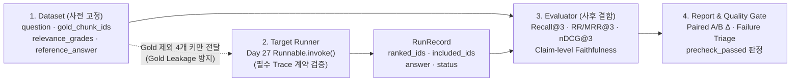

# Day 28 · RAG Evaluation & Debugging 실습 종합 보고서

> **수행 일자**: 2026-11-25
>
> **실습 트랙**: `01_basic` (`01_failure_diagnosis` ~ `08_agent_quality_report` 전 과정 완료)
>
> **실행 환경**: Windows 11 · Python 3.13 (`.backendenv`) · NVIDIA GeForce RTX 5080 (CUDA) · PostgreSQL (`knowledge_lab`, `pgvector`, 스키마 `d27_rag` 재사용) · OpenAI `gpt-4o-mini` (`LANGSMITH_TRACING=false`)

## 1. 핵심 아키텍처 요약

Day 27에서 구축한 LangChain RAG 파이프라인을 교체하지 않고, **Dataset(사전 고정) → Target Runner(`Runnable.invoke`) → Evaluator(Retrieval · Ranking · Generation) → Report & Quality Gate** 절차로 평가 체계를 구축했습니다.

### 절대 지켜야 할 4가지 평가 원칙

1. **Gold Leakage 원천 차단**: `safe_target_input()`에서 `question_id`, `question`, `category`, `history` 4개 키만 화이트리스트 복사해 정답(`gold_chunk_ids`, `reference_answer`)이 Target 입력으로 유입되지 않도록 분리했습니다.
2. **No-answer(`[]`)와 실패(`0.0`)의 엄격한 구분**: 정답 문서가 없는 질문(`Q06`)은 `Recall@k`·`RR`·`score_delta`에서 `0.0`이 아닌 `None(N/A)`으로 처리해 평균 왜곡을 막고 거절 성능 평가로 분리했습니다.
3. **Trace 누락 은폐 금지**: `evaluate_one()`에서 `ranked_ids`, `included_ids`, `answer`, `status` 중 하나라도 누락되면 빈 리스트로 대체하지 않고 즉시 `ValueError`를 발생시킵니다.
4. **1차 Quality Gate ≠ 운영 배포 승인**: `recall_mean`, `mrr_mean`, `invalid_sources`, `error_count` 1차 관문을 통과하더라도 `generation_review: "pending"` 항목의 `Faithfulness`·사람 검수·권한·Latency 검증이 별도로 필요합니다.

## 2. 모듈별 구현 및 검증 현황 (01 ~ 08)

모든 모듈에서 `--offline` 계약 검증 및 `pytest` 단위 테스트를 통과했고, 06~08번은 실제 GPU · PostgreSQL · OpenAI API 기반 **`--live` 실측**까지 완료했습니다.

| 모듈 | 핵심 구현 함수 (TODO) | 검증 모드 | 핵심 검증 결과 |
| :--- | :--- | :---: | :--- |
| **`01_failure_diagnosis`** | `classify_case`, `describe_evidence` | Offline | `F01`~`F05`를 `retrieval`, `rerank_or_context`, `generation`, `system_error`, `ok`로 순차 분류 |
| **`02_gold_dataset`** | `select_gold`, `validate_gold_ids` | Offline | `Q01`/`Q05`/`Q06([])`/`Q07(복수)` 모두 `valid_ids: true`, `target_example` Gold 미포함 확인 |
| **`03_retrieval_metrics`** | `calculate_recall`, `count_gold_hits` | Offline | `Q01` `1.0`, `Q07` `0.5`(2건 중 1건 Top-3), `Q06` `null(N/A)` 계산 |
| **`04_ranking_metrics`** | `first_relevant_rank`, `calculate_rr` | Offline | `Q01` 3위(`0.333`), `Q07` 2위(`0.5`), `Q06` `null` → 유효 평균 `MRR@3 = 0.417` |
| **`05_generation_quality`** | `claim_faithfulness`, `describe_claim_result` | Offline | `G01` `0.667`(비지원 1건), `G02` `0.0`, `G03` `1.0`, `G04` `null`(Claim 없음 구분) |
| **`06_langchain_runner`** | `safe_target_input`, `invoke_target` | Offline / **Live** | `Q02`·`Q03` 정상 Top-2 포함(`FAC-102-C1` 1위), `Q01` 빈 후보(`[]`) 관찰 |
| **`07_debug_comparison`** | `score_delta`, `find_problem_stage` | Offline / **Live** | Live `Q01`(`use_rewrite=False`) `baseline`·`rerank_only` 모두 `Recall@3=1.0`, `delta=0.0`, `diagnosis=ok` |
| **`08_agent_quality_report`** | `evaluate_one`, `summarize_all` | Offline / **Live** | Live `Q01`~`Q03` 집계 `recall_mean=0.3333` → `precheck_passed: false`로 안전 차단 |

## 3. 실측(Live) 디버깅 스토리 & 핵심 발견

### ① 모델 호환성 장애 격리 (`StageError`)
* 초기 6교시 `--live` 실행 시 `.env`에 지정된 모델이 `temperature=0.0`을 지원하지 않아 `400 BadRequestError`가 발생했습니다.
* 이때 파이프라인이 오류를 `insufficient_context`로 위장하지 않고 `StageError(rewrite:OpenAIInvalidRequestError)`로 즉시 격리하는 것을 확인했고, `LLM_MODEL=gpt-4o-mini`로 전환해 정상 실측을 완료했습니다.

### ② 6 → 7 → 8교시 교차 검증으로 밝혀낸 `Q01` 실패 원인
* **6교시 (`both`, `use_rewrite=True`)**: `Q02`·`Q03`은 정상 검색되었으나 `Q01`이 `ranked_ids: []`, `included_ids: []`로 비어 나왔습니다.
* **7교시 (`baseline` vs `rerank_only`, `use_rewrite=False`)**: 변수를 통제해 `rewrite`를 끄고 `Q01`을 실행하자 `baseline_recall: 1.0`, `rerank_recall: 1.0`, `diagnosis: "ok"`로 완벽히 통과했습니다.
* **8교시 (`both`, `use_rewrite=True`)**: `Q01`과 `Q03`의 상태가 **`status: "clarification_required"`**로 기록됨을 확인했습니다.
* **결론**: Retriever나 Reranker 문제가 아니라 **`rewrite` Stage의 LLM이 정상 질문까지 모호하다고 과민 판정해 조기 중단(Short-circuit)한 것**이 원인이며, 8교시 Quality Gate(`precheck_passed: false`)가 이 상태의 RAG가 Agent Tool로 승격되는 것을 정상적으로 차단했습니다.

## 4. 다음 단계 (Day 29 Agent Fundamentals 연계)

* Day 29에서는 검증된 RAG를 Tool Calling Agent의 `rag_search` Tool로 연결합니다.
* 실측에서 확인된 `rewrite` 과민 판정(`clarification_required`)을 조정해 Quality Gate를 통과시킨 뒤, `generation_review: "pending"` 항목의 사람 검수(Grounding), 권한 필터(`trusted_role`), 오류 상태 코드 계약과 함께 Agent Tool로 등록할 예정입니다.